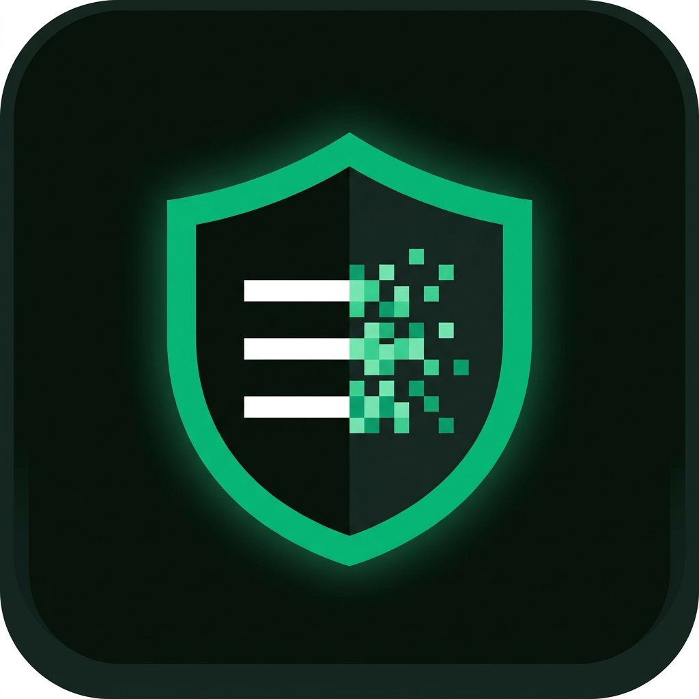
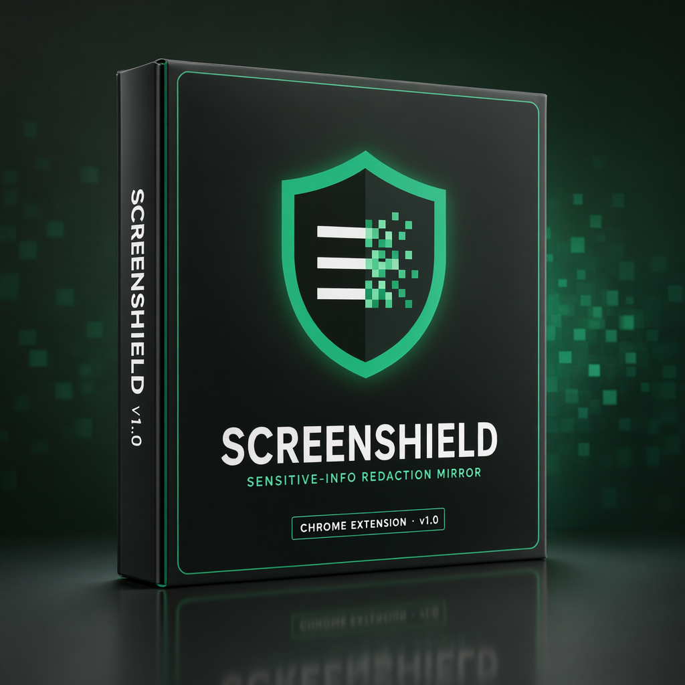
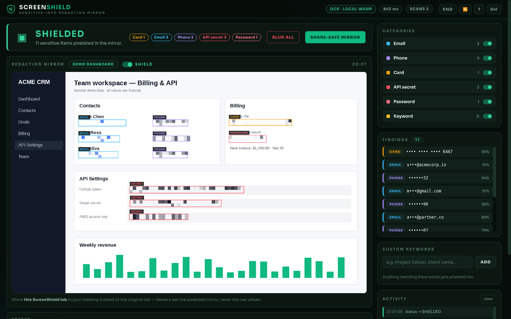
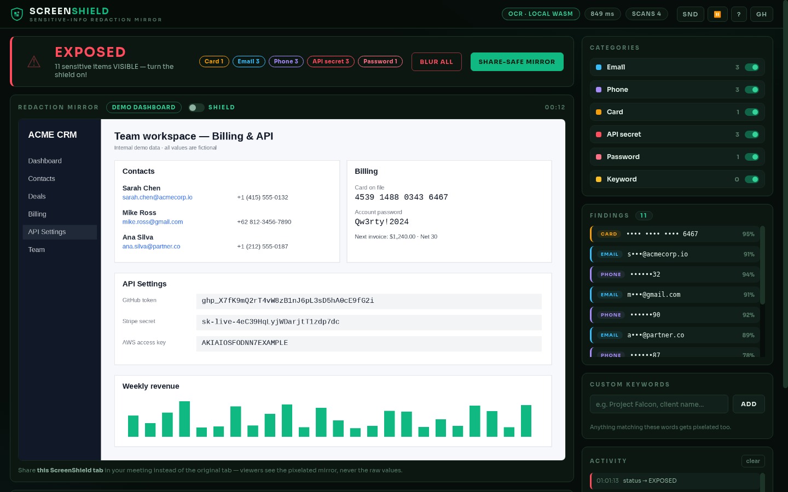
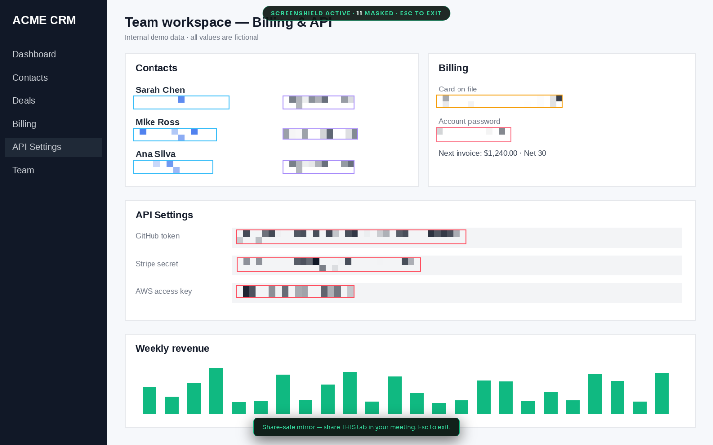
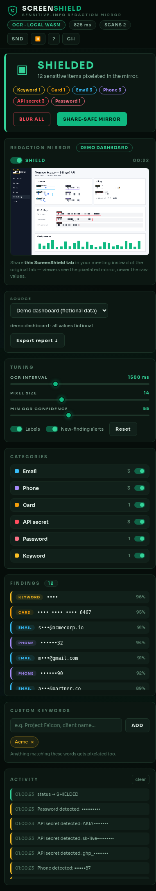

# ScreenShield — Sensitive-Info Redaction Mirror

<p align="center">
  <picture><source media="(prefers-color-scheme: dark)" srcset="promo/logo-white.png"></picture>
</p>

**See what your screen share is leaking — before your viewers do.**

ScreenShield is a Chrome extension that mirrors a screen or tab, OCRs it **fully locally** (Tesseract WASM, no network), and pixelates sensitive values in real time: emails, phone numbers, credit-card numbers (Luhn-validated), API keys, passwords and your own custom keywords. Then you share **the ScreenShield tab itself** in your meeting — a share-safe mirror — instead of the original window.

<p align="center">
  
</p>



## Why a mirror?

Blur overlays on the original tab don't help: screen sharing captures the raw window, and browser extensions can't intercept `getDisplayMedia`. ScreenShield flips the model — it renders a **redacted copy** of the source and you share that copy. Viewers only ever see the mirror; raw values never reach the meeting.

## How it works

```
source frame ──► local OCR (Tesseract WASM, PSM auto)
             ──► regex + geometry detectors ──► IoU-tracked findings
             ──► canvas pixelation mirror (downscale ▸ nearest-neighbour upscale)
```

1. **Capture** — demo dashboard (fictional data, built in) or any screen/tab via `getDisplayMedia`.
2. **OCR** — vendored `tesseract.js` 5.1.1, SIMD WASM core, English model. Runs in a local worker under the extension CSP (`workerBlobURL: false`, all paths vendored). Frames are OCR'd at native resolution up to 1600 px — downscaling further measurably hurts token accuracy.
3. **Detect** — per-line regexes mapped back to word bounding boxes:
   | Category | Rule |
   |---|---|
   | Email | standard address pattern |
   | Phone | 8–15 digits, international formats, never bridges UI columns |
   | Card | explicit 4-4-4-4 / 4-6-5 / unseparated groupings **and** Luhn checksum |
   | API secret | `ghp_`, `github_pat_`, `sk-live-`/`sk-test-` (OCR-tolerant `l`↔`1`), `sk-`, `AKIA…`, `xox…`, `AIza…` + generic 32+ char mixed-entropy tokens |
   | Password | geometric heuristic: a letter+digit/symbol token beside or below a "password/passcode/passwd" label |
   | Keyword | anything on your custom list (case-insensitive) |
4. **Track** — detections are associated across scans by IoU (>0.25, same category), smoothed (lerp 0.5) and kept alive with a TTL of `max(3 s, interval × 2.2)` so the mirror doesn't flicker between scans.
5. **Redact** — each finding is pixelated (block size tunable 6–28 px) with a category-coloured outline and label. `BLUR ALL` pixelates the entire frame instantly.

### Engineering notes (calibrated, not guessed)

- **Column-aware line joining.** OCR merges table columns into one line. Words separated by a wide horizontal gap (> 3 × line height) are joined with a triple space, and detector patterns are written so they never bridge that gap. Without this, a greedy digit-run regex swallowed *phone + card* into one 19-digit invalid match and **both** were missed.
- **Explicit card groupings.** A loose `(?:\d[ -]?){13,19}` pattern starts matching inside the phone number and eats the card. ScreenShield matches real card layouts only, then Luhn-validates.
- **Secret confidence.** Random tokens get near-zero per-character OCR confidence (a perfectly read `ghp_…` scored 14/100). The prefix pattern is the strong signal, so SECRET findings inherit the line-level confidence.
- **Password geometry.** Line-order heuristics break when OCR reorders columns. Instead, ScreenShield finds the label word and searches for a value token beside it (same row) or below it (≤ 2.5 line-heights, horizontally aligned), excluding anything already claimed by another detector.
- **Background-safe.** The scan loop is timer-driven and draws its own frames — it keeps working when the tab is not focused (which it usually isn't during a meeting).

## Privacy

- All OCR runs **locally in WASM**. Nothing is uploaded, ever.
- Findings store **masked previews only** (`s•••@acmecorp.io`, `•••• •••• •••• 6467`). Raw values are never persisted, logged or exported.
- The JSON report contains masked values, boxes, confidences and events — no raw text.
- Permissions: `storage` only (tuning + keywords).

## Honest limits

- OCR can miss stylized, tiny, rotated or low-contrast text.
- Redaction lags fast-moving content by one scan interval (~1–3 s).
- The password detector is a heuristic, not a semantic understanding.
- **Always double-check the mirror before presenting.** This is a safety net, not a guarantee.

## Usage

1. Load unpacked (`chrome://extensions` → Developer mode → Load unpacked → this folder), click the toolbar icon.
2. Pick **Source → Screen / tab** and share the window you're about to present.
3. Press **Share-safe mirror** (`F`) — the page becomes a clean full-screen redacted mirror.
4. In your meeting, share **this ScreenShield tab** instead of the original window.

Shortcuts: `Space` pause · `F` mirror mode · `B` blur all · `S` sound · `?` help · `Esc` exit.

Tuning: OCR interval (800–3000 ms), pixel size (6–28), min OCR confidence (30–90), labels, alerts. Per-category toggles and custom keywords in the side panel.

## Screenshots

| Shielded | Exposed (shield off) |
|---|---|
|  |  |

| Share-safe mirror | Mobile layout |
|---|---|
|  |  |

## Test harness

End-to-end tested in real Chromium under Xvfb with puppeteer-core and fake media devices: OCR boot, all five detector categories on the demo dashboard (11 findings by scan 2), shield on/off status machine, custom keywords, category toggles, panic blur, mirror mode, pause freeze, log, report, help, screen-capture pipeline, 390 px mobile layout, zero console/page errors.

## Promo kit

| File | What |
|---|---|
| `promo/logo.png` | app logo |
| `promo/logo-white.png` | logo for dark backgrounds |
| `promo/software-box.png` | product box render |
| `promo/poster.png` | feature poster |
| `promo/banner.png` | wide banner |
| `promo/promo.mp4` | 8 s promo video |

## Credits & licenses

- Code: MIT (see `LICENSE`).
- [tesseract.js](https://github.com/naptha/tesseract.js) — Apache-2.0, vendored in `vendor/`.
- [Tesseract OCR](https://github.com/tesseract-ocr/tesseract) + `eng.traineddata` — Apache-2.0.
- [Sora](https://fonts.google.com/specimen/Sora) font — SIL OFL 1.1, bundled.
- Demo dashboard: **all names, emails, phones, cards and keys are fictional** (Luhn-valid test number, AWS example key). Any resemblance to real data is coincidental.